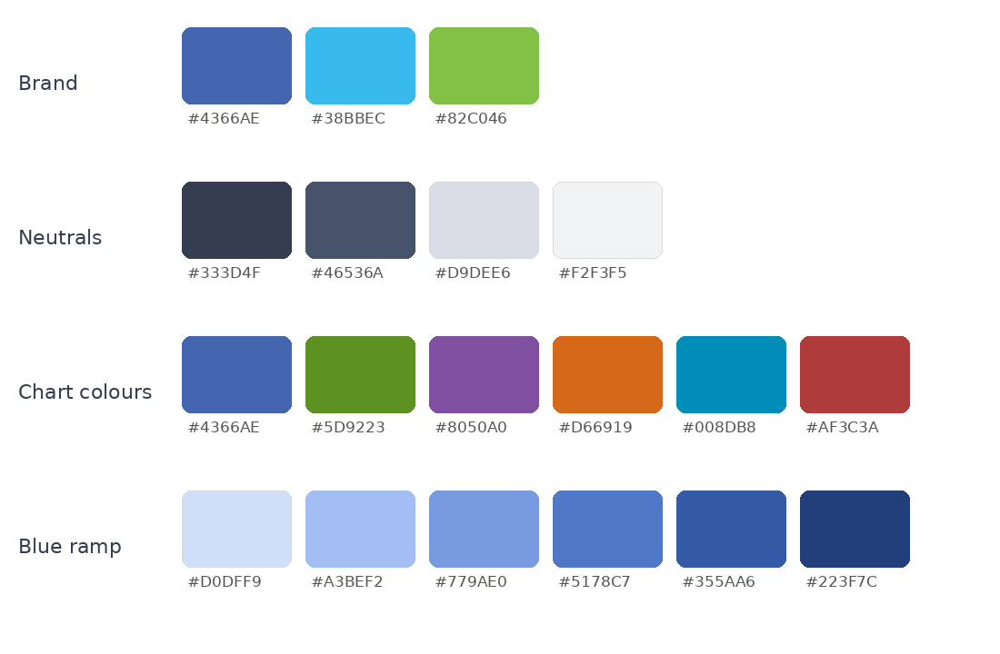

# Decarb-AI colours

**Brand.** For headers, section tabs and the gradient. Cyan and green are too pale for text or thin lines on white.

| | Hex |
|---|---|
| Blue | `#4366AE` |
| Cyan | `#38BBEC` |
| Green | `#82C046` |

The gradient runs blue, cyan, green: `linear-gradient(100deg, #4366AE, #38BBEC 52%, #82C046)`.

**Neutrals.** Slate `#46536A` and deep slate `#333D4F` for structure, light slate `#D9DEE6` for borders and grid
lines, `#1A1A1A` for text, `#F2F3F5` for the poster background.

**Chart colours.** For lines, bars and points in figures, used in this order. They keep the brand hues, darkened
until each reads on white, plus three warm colours to tell series apart. The order keeps neighbouring colours
distinct for colour-blind readers too.

| | Hex | Also fine for coloured text |
|---|---|---|
| 1 Blue | `#4366AE` | yes |
| 2 Green | `#5D9223` | no |
| 3 Purple | `#8050A0` | yes |
| 4 Orange | `#D66919` | no |
| 5 Cyan | `#008DB8` | no |
| 6 Red | `#AF3C3A` | yes |

Use one colour per series and keep the order, so series 1 is always blue. More than six series is a sign to group
them or split the figure.

**Blue ramp.** For maps and heat maps where colour shows an amount, light to dark:
`#D0DFF9` `#A3BEF2` `#779AE0` `#5178C7` `#355AA6` `#223F7C`.

## In your tools

- **Poster:** already set in `poster/decarb.css`.
- **Slides:** `decarbchart1` to `decarbchart6` in the Beamer theme.
- **matplotlib:** `plt.style.use("decarb.mplstyle")` sets the chart colours in order.
