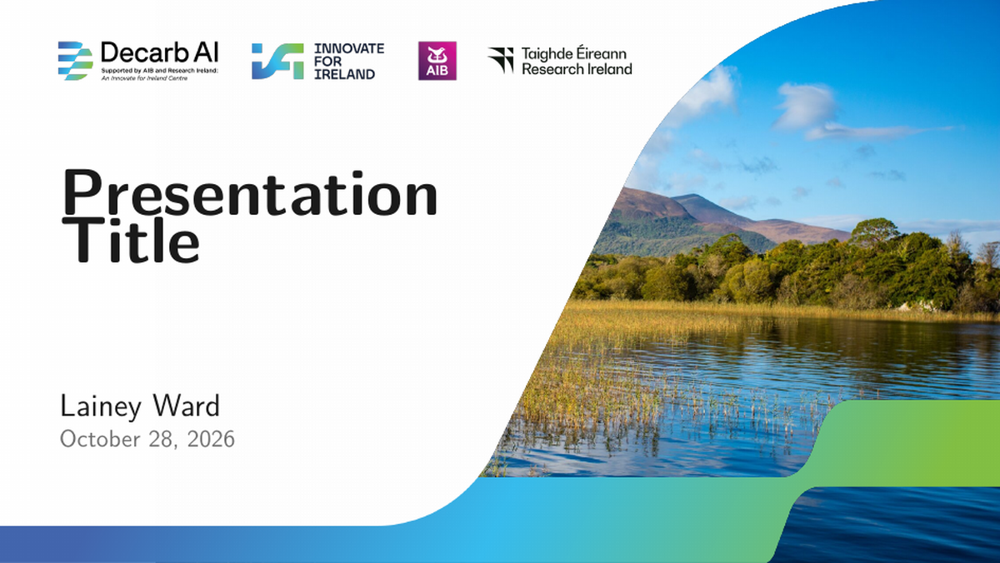
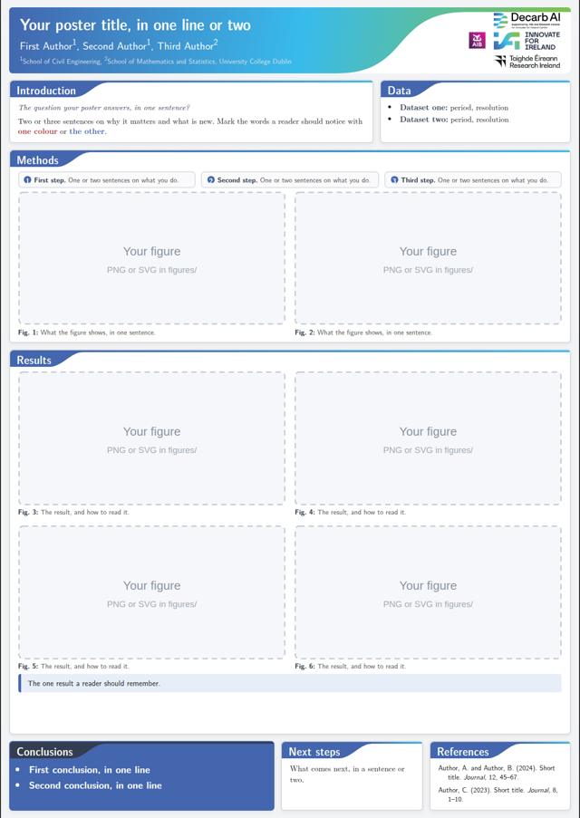
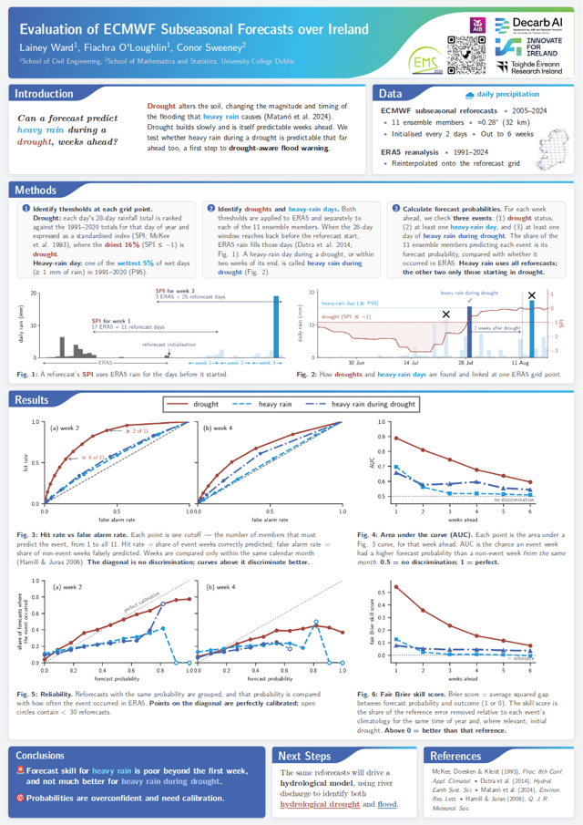

# Decarb-AI templates

Slides and a poster in the Decarb-AI style, ready for your own research.

| Slides | Poster | Example poster |
|:---:|:---:|:---:|
|  |  |  |

## Slides

LaTeX Beamer, 16:9. **[Open in Overleaf](https://www.overleaf.com/docs?snip_uri=https://github.com/LaineyLouiseWard/decarb-ai-templates/releases/latest/download/decarb-slides.zip)**,
or download `slides/` and run `latexmk -pdf main.tex`.

Set your title, name and date at the top of `main.tex`, then replace the example slides with your own.

## Poster

A0 portrait, written in HTML so it prints from any browser.

1. Download `decarb-poster.zip` from [Releases](https://github.com/LaineyLouiseWard/decarb-ai-templates/releases/latest), or copy the `poster/` folder.
2. Edit `poster.html`: your title, text and figures (figures go in `figures/`).
3. Open `poster.html` in Chrome and print to PDF. The page is already A0.

`python render.py` makes the PDF from the command line and tells you if any text overflows.

## With an AI assistant

Open the repo in Claude Code, Codex or Cursor and ask for what you need, for example "make a poster from my abstract
and these figures". `AGENTS.md` tells it which file to edit and which building blocks to use.

## Colours

[PALETTE.md](PALETTE.md) lists the brand colours and six chart colours for figures. In matplotlib,
`plt.style.use("decarb.mplstyle")` applies them.

## Licence

The code is MIT licensed. The logos and brand graphics belong to Decarb-AI and its funders; use them only for
Decarb-AI work.
